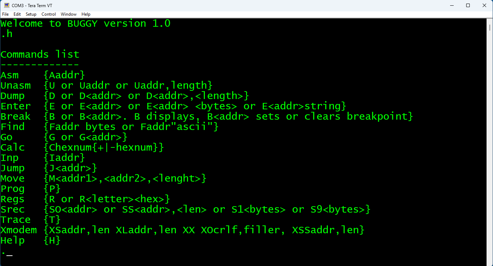

##### **Buggy machine language monitor and rudimentary O.S. version 1.0 **

By Lennart Benschop

##### Running on the 68retro 

The monitor uses RAM from \$0000 to \$0400, so you can use any size RAM chip.

There is an ACIA at \$E000-\$E003, set the IO Page to \$E0 on the MP-09.
Use the A2,A3,A4 address straps on the MP-IO (version 2) and strap 0 for the ACIA on J3.
If you have a version 3 MP-IO put both  A7 jumpers (A7H and A7L) to the left (1,2) to enable I/O when A7 is low. 

It looks like a timer FIRQ is required for the 'trace', I have yet to explore how this works.

There are two source files for the monitor, monitor.asm and mon2.asm 
You will need an 8k ROM for the monitor, code starts at \$E400 so the 'E' Rom Bank switch should be selected. 

monitor.asm 
The Buggy monitor without the prompt or help messages.

mon2.asm  

The Buggy monitor with the decimal point prompt and H help message.

